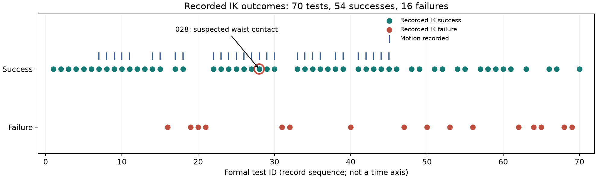

# Mobile Robot Integration and Validation

**Vision–ground coordinate consistency, fingertip-target IK experiments, and dexterous-hand application development on a commercial mobile dual-arm robot.**

Siyuan Lin · Robotics Systems Integration Internship · Suzhou Jiuwu Intelligent Technology Co., Ltd. · Summer 2026

This portfolio documents practical integration and testing work on a wheeled robot with two seven-axis MARVIN arms, a movable head camera, and Inspire dexterous hands. The engineering question was how to verify that perception coordinates, kinematic calculations, controller feedback, and end-effector sensing agree before relying on them for manipulation.

Start with the [technical case study](docs/technical-case-study.md), then inspect the [recorded IK results](data/ik/README.md) and [ROS 2 examples](examples/README.md). The [offline model](offline_kinematics/README.md) can be explored without a robot.

## My work

My internship work combined test configuration and execution with coding-assisted adaptation of application clients and diagnostic workflows:

- Checked camera-to-ground transformations while varying head yaw and pitch; organized terminal observations into stable and transitional segments for drift analysis.
- Ran arm drag, hand open/close, and assisted bimanual grasp/load observations with colleagues; varied Cartesian offsets and recorded IK feasibility, joint feedback, and physical clearance.
- Adapted B-hand service calls to arm B / COM3 / device ID1 and continuous Bash acquisition, including timeouts and clean interruption; inspected fingertip tactile and six-channel actual-force responses.
- Participated in grasp-client iteration around completion checks and register readback; reported field behavior, deployed a revised client, and returned robot-side diagnostic output. See [hand-control development](docs/hand-control-development.md).
- Adapted the fingertip-target IK workflow with coding assistance: clarified sensor/TCP transforms, diagnosed missing body-state input, and used an explicit assumed-body calculation mode for the constrained setup. See [IK client development](docs/fingertip-ik-development.md).
- Configured navigation maps, virtual walls, restricted zones, docking positions, and routes in Leju Mobile/Design, as described in my CV. No exported map or navigation configuration was supplied for this repository.

Codex assisted client adaptation and debugging. The robot platform, vendor SDK, and supplied ROS drivers are existing dependencies. Their source is attributed in [provenance and licensing](docs/provenance.md). This repository presents my integration and test work; it does not claim authorship of the underlying robot controller or IK solver.

## Technology stack

| Layer | Technologies and role |
| --- | --- |
| Application and analysis | Python, ROS 2 clients, NumPy kinematics and CSV analysis |
| Diagnostics | Bash polling, RS485 vendor framing and a standard-library Modbus TCP client |
| Native dependency | Vendor C++ control/kinematics SDK and C++ examples, preserved with attribution in the source release |
| Robot environment | Ubuntu/Linux, ROS 2 Humble and the existing Pinocchio service/model |

The vendor C++ sources are available in the [dependency source release](https://github.com/dddddddddl/robotics-internship-integration/releases/tag/source-snapshots-v1), alongside their original license notices.

## Selected observations

| Workstream | Observation | Evidence and interpretation |
| --- | --- | --- |
| IK testing | 70 formal records: 54 solver successes, 16 failures; one additional repeat | Recomputed from supplied [test summaries](data/ik/records.csv); 29 formal records describe actual motion. |
| Numerical boundary refinement | X+, Y+, Z+ success/failure brackets narrowed to 6.25 mm in later dry runs | Different directions and fixed baselines; these are solver/service acceptance brackets, not measured collision-free workspace. [Details](data/ik/README.md). |
| Physical clearance | Test 028 solved and moved, but suspected waist contact was reported; test 029 records retraction | Preserved as an adverse result, not counted as a safe manipulation success. |
| Vision consistency | Diary reports 568 yaw records, about 5.3 mm pitch-associated drift and 38 mm yaw-associated drift | Original vision logs/CSVs were not supplied. These are reported observations, not independently reproduced accuracy measurements. |
| Hand application regression | 14 supplied hand tests passed again during the supplementary review | Checks framing, target parsing, completion rules and ignored writes; the last supplied A-hand grasp run stopped at a pre-motion RS485 read timeout. [Development notes](docs/hand-control-development.md). |
| Hand sensing | Contact-sensitive tactile readings, changing thumb channels, and intermittent RS485 timeouts | Qualitative diary observations; no calibrated force curve or raw acquisition dataset is available. |



## Repository guide

| Location | What to inspect |
| --- | --- |
| [docs/technical-case-study.md](docs/technical-case-study.md) | Methods, engineering observations, and interpretation |
| [docs/hand-control-development.md](docs/hand-control-development.md) | Hand application modules, command/feedback decisions, field debugging and 14 offline checks |
| [docs/fingertip-ik-development.md](docs/fingertip-ik-development.md) | Sensor-to-TCP targets, state-source diagnosis and guarded execution |
| [examples/](examples/README.md) | English ROS 2 clients and B-hand polling scripts |
| [offline_kinematics/](offline_kinematics/README.md) | NumPy kinematic model, frame transforms, and plotting helpers |
| [experiments/ik/](experiments/ik/README.md) | Waypoint/grid utilities and recorded-joint visualization |
| [data/ik/](data/ik/README.md) | English CSV, reproducible counts, original-language evidence, and limitations |
| [third_party/](third_party/README.md) | Dependency source bundles, checksums, original license notices |
| [docs/validation.md](docs/validation.md) | What was checked on this computer and what still needs hardware |

## Run the offline material

Python 3.12 was used for the preparation checks. From the repository root:

```bash
python3 -m venv .venv
source .venv/bin/activate
python -m pip install -r requirements.txt
python tools/summarize_ik.py --output-dir results/ik --plot results/ik-outcomes.png
python offline_kinematics/run_jibot.py camera-ground
python experiments/ik/view_ik_result.py data/ik/records.csv --point-index 7 --arm A --no-plot
python -m pytest -q
```

These commands analyze records or calculate model transforms; they do not connect to a robot. Model examples use example joint values, not newly collected measurements. See [offline usage](offline_kinematics/README.md) for units and plotting.

Robot-connected examples need Ubuntu/ROS 2 Humble, the appropriate controller/native SDK, the matching generated interfaces, and the real platform. [Setup](docs/robot-setup.md) explains dependency retrieval and service prerequisites. The relevant drivers, interfaces, helper modules, native libraries, and configurations are supplied together in [source snapshot releases](https://github.com/dddddddddl/robotics-internship-integration/releases/tag/source-snapshots-v1), rather than leaving only main scripts in the repository.

## Scope and limitations

The August runtime snapshot contains arm/leg Pinocchio services, but does **not** contain the later `PinocchioFullBodyIK` interface and `/ik/full_body_ik` implementation used by the formal test records. Those later clients are retained separately as references. The numerical records can be inspected and summarized, but their solver runs cannot be reproduced from the supplied backend.

No robot, ROS 2 runtime, camera, or calibrated force reference was available during portfolio preparation. No hardware motions were executed here. The English documentation, normalized tables, outcome figure, dependency fetcher, and additional checks were created during preparation; they are not presented as original internship deliverables.

Original-language evidence and third-party source snapshots retain some Chinese text, protocol field names, and legal notices. The primary reading path and selected examples are English. See [source attribution](docs/provenance.md) for the upstream MARVIN repository and controller compatibility notes.
