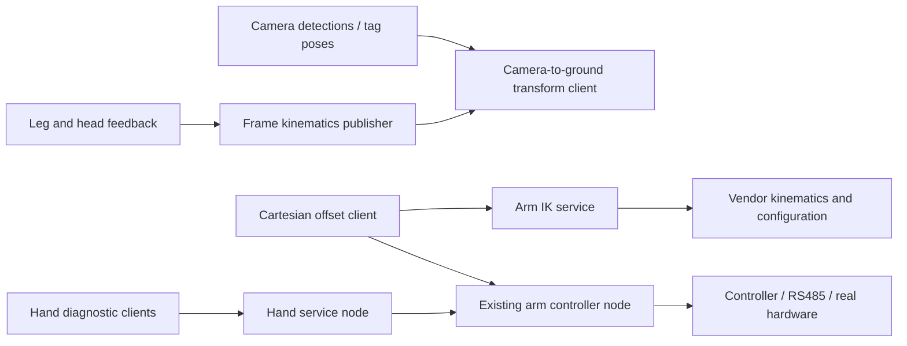

# Integration and validation case study

## Platform and task

The internship involved a commercial mobile dual-arm platform. The supplied source covers a four-joint leg/body chain, a two-joint camera head, two seven-axis arms, and dexterous hands connected through end-effector RS485. ROS 2 topics carry frame and joint feedback; services expose arm and hand operations. Navigation configuration used Leju Mobile/Design alongside the manipulation tests.

The practical goal was to understand how these components behaved together: whether a stationary object's ground-frame coordinates remained consistent as the camera moved, whether an IK target could be solved and safely approached, and whether hand sensing responded to contact without blocking the test workflow.

The later full-body service used in the recorded experiments is a separate dependency absent from the supplied runtime. The diagram above describes the available classic arm-service path.

## Camera-to-ground consistency

For a fixed base and target, changing the camera head orientation should change camera-frame target coordinates while leaving the transformed ground-frame target approximately constant:

`p_ground = T_ground_camera(q_leg, q_head) · [p_camera; 1]`

The selected clients consume a row-major 4×4 `RobotFrames.ground_camera` matrix. One transforms detection positions; the other composes full tag poses, including orientation. The ordinary detection client assumes upstream detections already contain metric 3D positions in `result.pose`; a 2D bounding box alone does not provide depth. The tag client uses `/apriltags/poses`; the diary does not establish the exact tag family used in every experiment.

My test procedure varied head pitch or yaw while keeping the target and base stationary, checked actual joint feedback against the intended angle ranges, and separated transition samples from settled samples. Comparing settled group means estimates orientation-dependent drift; within-group standard deviation describes repeatability. Without an independently surveyed target position, neither is an absolute localization accuracy measurement.

The diary reports pitch-associated displacements of approximately 3.42 mm from −0.1 to 0 rad, 3.53 mm from 0 to 0.1 rad, and 5.30 mm between −0.1 and 0.1 rad. These are Euclidean distances between positions, so the endpoint distance need not equal the sum of the two intervals.

For yaw, the diary describes four files of 142 complete records each, totaling 568, with pitch held near 0.3 rad and yaw spanning roughly −0.2 to 0.2 rad. Reported endpoint changes were approximately 3 mm in ground X, 33 mm in Y, and 18 mm in Z, giving about 38 mm in 3D. One file largely contained the settled endpoint rather than its full transition.

The systematic Y trend motivated checking camera extrinsics, joint zero offsets, rotation-axis placement, frame conventions, and timing alignment. These are possible causes to investigate, not verified root causes or claims of a completed calibration improvement. The original vision logs and derived CSVs were not found among the supplied materials; the values above are faithfully reported from the diary and CV.

## Arm IK and physical testing

The available classic offset example reads the current body-frame TCP, applies a Cartesian offset, converts the target into the vendor IK base frame, and requests a joint solution. Translation is specified in millimeters and rotation in degrees. It calculates by default; motion requires `--execute`.

The later experiment records refer to an index-fingertip control point and a full-body IK service, not simply the classic TCP offset example. The records distinguish numerical failure, service safety rejection, dry-run success, and executed movement. They also use several baseline poses. Combining all offsets into one global reachable-volume estimate would erase those distinctions.

I varied offsets and inspected solver and controller feedback, including reported joint arrival errors. A sequence of five 10 mm steps records successive joint-target execution; it does not establish straight-line Cartesian tracking between those joint waypoints. The [IK evidence guide](../data/ik/README.md) gives the refined dry-run brackets and their limitations.

Test 028 is an important physical observation: a numerical solution and arrival were recorded at a cumulative Y− displacement of 450 mm, but suspected contact with the waist was reported. The preceding 400 mm point had no contact reported. Test 029 records a 50 mm Y+ retraction with clearance confirmation. This supports treating the interval as an observed clearance concern for that setup, not a general collision map.

## Hand interfaces and bimanual observations

The diary describes assisting colleagues with arm drag-mode positioning, opening/closing hands, and observing grasp/load stability. The observations concerned slipping, object tilt, arm sag, vibration, and release behavior. No measured payload limit, lifting benchmark, or controller design claim is made.

For the right/B hand, I adapted the service arguments to `arm_id=B`, `com=3`, and `hand_id=1`, then used repeatable Bash polling with timestamps, per-call timeouts, and Ctrl+C handling. The read-only direct-transfer examples retain the alternative A-arm/COM2 profile; these profiles should not be confused.

`/hand/read_touch` returned normal and tangential fields for five fingertips. The diary describes near-zero unloaded readings and nonzero index-finger response under light contact. Intermittent RS485 response timeouts motivated slower polling and longer request timeouts; no measured timeout rate is available.

`/hand/read_actual_forces` returned six device channels: pinky, ring, middle, index, thumb flexion, and thumb rotation. A representative unloaded vector was `[55, 64, 160, 193, -32, 63]`. The diary reports thumb-channel ranges of approximately −136 to 2430 and −554 to 141 during manual loading, followed by return toward baseline. These are device values, not calibrated newtons. Because action changes were not timestamp-annotated, the records do not establish an exact mapping between each manual loading direction and each response.

The supplementary [hand-development notes](hand-control-development.md) explain the later grasp/position applications, their regression checks and the last supplied field failure. The [IK-development notes](fingertip-ik-development.md) trace the sensor-to-TCP target and body-state diagnosis. These deepen the development account without adding new physical experiments.

## Navigation experience

The CV describes configuring multi-zone maps, virtual walls, no-go areas, docking locations, and routes using Leju Mobile/Design, plus checking ROS 2 nodes, topics, and transform chains. The supplied archive does not contain an exported navigation project, measured route-success dataset, or a personally authored navigation stack. This work is included as internship context rather than represented by unrelated navigation source from the larger workspace.

## Lessons and next measurements

The records support a practical distinction among model consistency, numerical feasibility, service acceptance, and physical clearance. Stronger follow-up evidence would include synchronized raw camera logs, surveyed target coordinates, annotated hand loading events, a calibrated force reference, and the matching full-body service implementation. These would allow the existing observations to be independently recomputed and extended.
